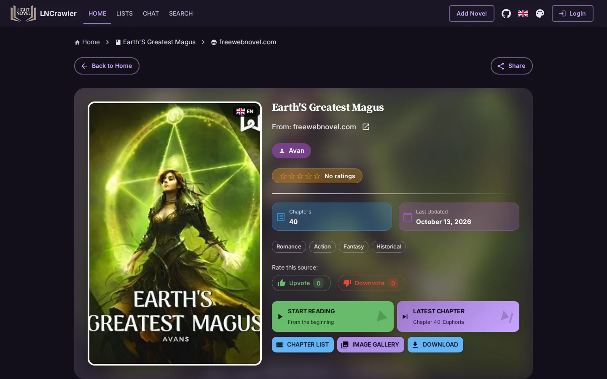
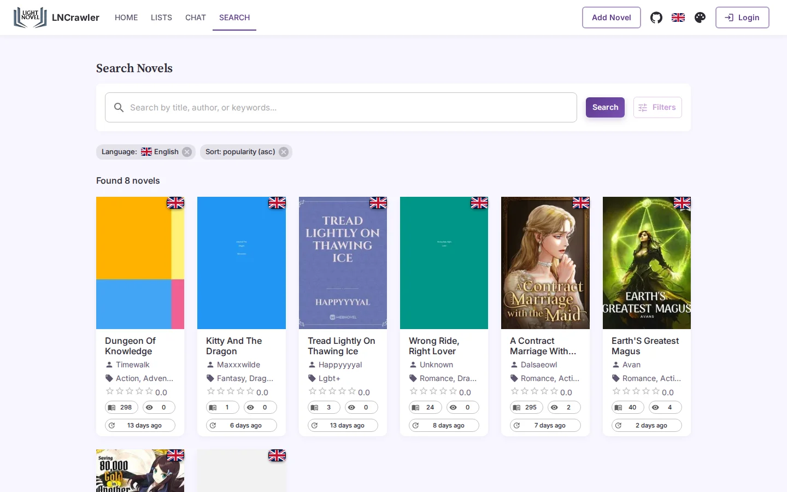
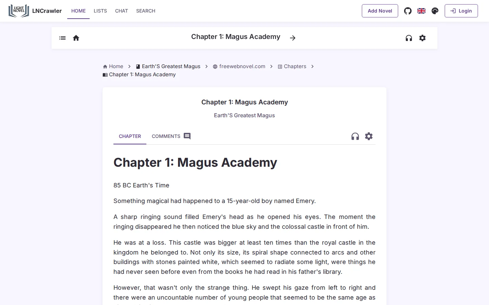
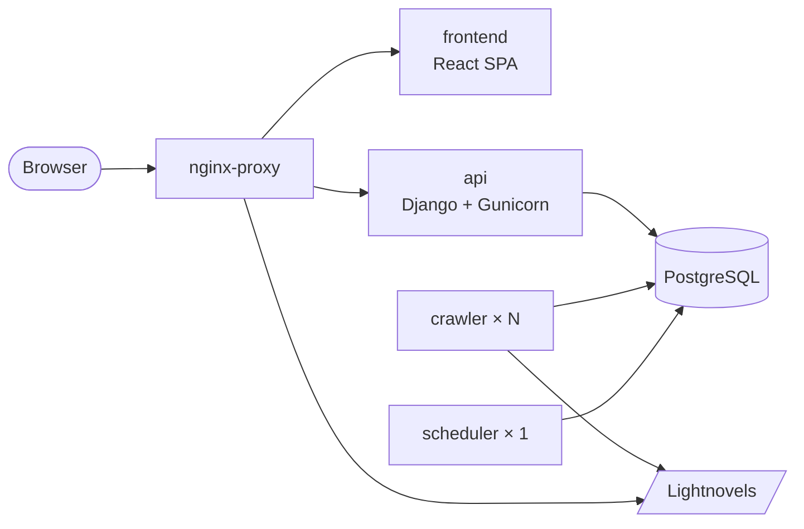

<p align="center">
  
</p>

<h1 align="center">LNCrawler</h1>

<p align="center">
  <b>Self-hosted light novel reader with its own crawler.</b><br>
  Search a source, download a novel, read it in your browser — all on your own server.
</p>

<p align="center">
  <a href="https://lncrawler.monster"></a>
  <a href="LICENSE"></a>
  <a href="https://github.com/jere344/LNCrawler/stargazers"></a>
  <a href="https://github.com/jere344/LNCrawler/commits"></a>
  <br>
  
  
  
  
</p>

<p align="center">
  <a href="#-quick-start">Quick start</a> ·
  <a href="#-features">Features</a> ·
  <a href="#-architecture">Architecture</a> ·
  <a href="#%EF%B8%8F-configuration">Configuration</a> ·
  <a href="#-contributing">Contributing</a>
</p>

---

<p align="center">
  
</p>
<table>
  <tr>
    <td width="50%"></td>
    <td width="50%"></td>
  </tr>
</table>

## ✨ Features

- **📚 Library** — browse, search and filter novels; download from supported sources in 30+ languages straight into the library, or let the harvest feeder fill it automatically.
- **📖 Reader** — configurable font, colors, margins, scroll or pagination, chapter preloading, resume where you left off.
- **🔊 Text-to-speech** — browser voices or in-browser neural voices (Kokoro, Piper), no server cost.
- **👥 Community** — accounts, reading lists, history, reviews, per-chapter comments, forums, friends.
- **🧹 Self-maintaining** — duplicate novel and tag detection with an optional LLM tie-breaker, scheduled pruning, imports from a drop folder.
- **🛠️ Admin** — novels, sources, jobs, users and on-demand maintenance tasks.
- **🌍 Everywhere** — 20 UI languages, sitemap, robots.txt, SEO pre-rendering, optional GitHub issue per unexpected error.

## 🚀 Quick start

Requires [Docker](https://docs.docker.com/get-docker/) with the `docker compose` plugin.

```bash
git clone https://github.com/jere344/LNCrawler.git
cd LNCrawler
cp .env.example .env        # set at least SECRET_KEY, POSTGRES_*, SITE_URL, SITE_API_URL
docker compose up -d --build
```

On first boot the API migrates, collects static files and creates the superuser from `DJANGO_SUPERUSER_*`. With the default `.env`:

| What     | URL                          |
| -------- | ---------------------------- |
| Frontend | http://localhost             |
| API      | http://api.localhost         |
| Admin    | http://api.localhost/admin (`admin` / `admin`) |

> [!TIP]
> If `*.localhost` doesn't resolve, add `127.0.0.1 localhost api.localhost` to `/etc/hosts`. If port 80 is taken, change `NGINX_PORT`.

```bash
docker compose logs -f api   # follow logs
docker compose down          # stop (add -v to drop the database)
```

## 🏗️ Architecture



| Service       | Role |
| ------------- | ---- |
| `db`          | PostgreSQL 17. |
| `api`         | REST API, admin, static/media/library files. |
| `crawler`     | Workers claiming search/download jobs from the DB-backed queue. Scale freely. |
| `scheduler`   | Periodic maintenance and the harvest feeder. Keep exactly one. |
| `frontend`    | React + Vite SPA, built into the image and served by Nginx. |
| `nginx-proxy` | Public entry point; routes by `Host` and serves `/static`, `/media`, `/lightnovels`. |

The crawler engine (`lncrawl` + `sources/`) lives in [`lncrawler-crawler/`](lncrawler-crawler) and is driven by the API through [`downloader_service.py`](lncrawler-api/lncrawler_api/services/downloader_service.py).

<details>
<summary><b>Project structure</b></summary>

```
lncrawler/
├── docker-compose.yml
├── .env.example
├── nginx-proxy/         # public reverse proxy
├── lncrawler-api/       # Django API, workers, maintenance commands
├── lncrawler-frontend/  # React + Vite SPA
├── lncrawler-crawler/   # crawler engine and sources
├── Lightnovels/         # downloaded library (volume)
└── imports/             # drop folder for run_import (volume)
```

</details>

## 🌐 Deployment

`nginx-proxy` speaks plain HTTP: terminate TLS in front of it (Caddy, Traefik…) and forward to `NGINX_PORT`. Then set:

```env
SITE_URL=https://your.domain
SITE_API_URL=https://api.your.domain
DEBUG=False
CORS_ALLOW_ALL_ORIGINS=False
```

Hosts and the frontend's API URL are derived from these. Rebuild the frontend image after changing `SITE_API_URL` (it is compiled in).

**Scaling** — crawler workers are independent: set `CRAWLER_REPLICAS=4` or run `docker compose up -d --scale crawler=4`. Keep a single `scheduler`; DB locks prevent double runs anyway.

## ⚙️ Configuration

Everything lives in `.env`; [`.env.example`](.env.example) documents every default.

<details>
<summary><b>All settings</b></summary>

| Group | Variables |
| ----- | --------- |
| Database | `POSTGRES_DB`, `POSTGRES_USER`, `POSTGRES_PASSWORD`, `POSTGRES_HOST` (`db`), `POSTGRES_PORT` (`5432`) |
| Django | `SITE_URL`, `SITE_API_URL`, `SECRET_KEY`, `DEBUG` (`True` = dev server, `False` = Gunicorn), `CORS_ALLOW_ALL_ORIGINS`, `LOG_LEVEL` |
| Superuser | `DJANGO_SUPERUSER_USERNAME`, `DJANGO_SUPERUSER_EMAIL`, `DJANGO_SUPERUSER_PASSWORD` (first boot only) |
| Email | `EMAIL_HOST`, `EMAIL_PORT`, `EMAIL_USE_TLS`, `DEFAULT_FROM_EMAIL`, `EMAIL_SENDER_NAME` — SMTP for password reset; printed to console without credentials |
| Proxy | `NGINX_PORT` (`80`). `API_HOST`, `FRONTEND_HOST`, `VITE_API_BASE_URL` are derived — don't set them |
| Crawler | `CRAWLER_REPLICAS`, `CRAWLER_CONCURRENCY` (`5`), `CRAWLER_MEM_LIMIT` (`2g`), `CRAWLER_POLL`, `CRAWLER_STALE_MINUTES`, `CRAWLER_REQUEUE_EVERY` |
| Source logins | `LNCRAWL_<KEY>_USERNAME` / `LNCRAWL_<KEY>_PASSWORD`, `<KEY>` = source domain label uppercased |
| Maintenance | `SCHEDULER_ENABLED` (`True`), `LNCRAWL_PRUNE_APPLY` (`False` skips the destructive prune) |
| Harvest feeder | `HARVEST_INTERVAL`, `HARVEST_REFRESH_SECONDS`, `HARVEST_SCAN_TIMEOUT` — enable it in **Admin → Maintenance → Harvest** |
| LLM (optional) | `MERGE_LLM_*`, `TAG_LLM_DAILY_LIMIT` — any OpenAI-compatible endpoint for merge/tag decisions |
| Error reporting | `GITHUB_REPO`, `GITHUB_TOKEN` (`issues:write`), `GITHUB_ISSUES_ENABLED` |

</details>

## 🧰 Common operations

Most tasks are one click away in **Admin → Scheduled tasks → Maintenance** (harvest, imports, source tests, any scheduled task). From the shell:

```bash
docker compose exec api python manage.py run_import --action copy
docker compose exec api python manage.py check_source --url NOVEL_URL
docker compose exec api python manage.py help    # list all commands
```

## 🤝 Contributing

Issues and pull requests are welcome. Adding or fixing a source? Read the [source guide](lncrawler-crawler/SOURCE_GUIDE.md) and run the harness before opening a PR:

```bash
docker compose exec api python manage.py check_source --url NOVEL_URL
docker compose exec api python manage.py check_source --file sources/en/x/foo.py --query "reincarnation"
```

## 🙏 Acknowledgements

The crawler engine and many sources are ported from [lightnovel-crawler](https://github.com/dipu-bd/lightnovel-crawler).

## ⚖️ License & disclaimer

Released under the [GPL-3.0](LICENSE). LNCrawler is a tool: you are responsible for respecting the terms and copyright of the sites you crawl and the content you host.

<p align="center"><sub>If LNCrawler is useful to you, a ⭐ helps others find it.</sub></p>
